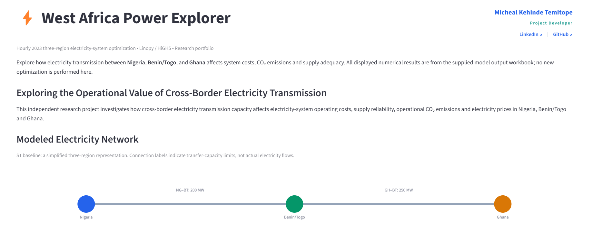
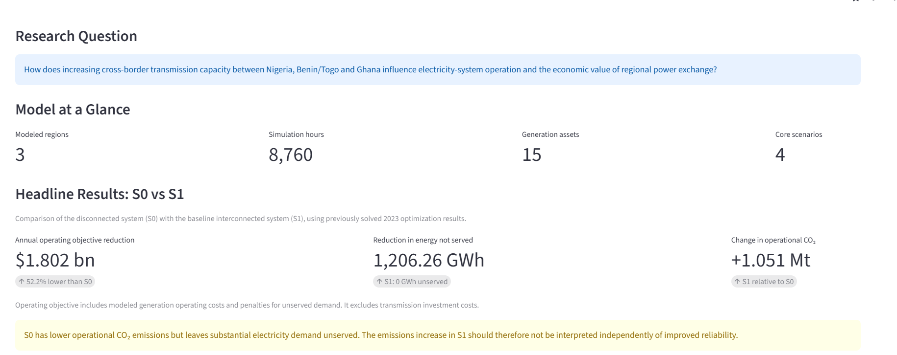

# ⚡ West Africa Power Explorer

### Electricity Market Optimization | Cross-Border Transmission | Energy Systems Modeling

**An interactive research portfolio exploring the operational value of cross-border electricity transmission in West Africa.**

🌐 **[Explore the Live Dashboard](https://west-africa-power-explorer.streamlit.app/)**

**Technologies:** Python · Linopy · HiGHS · Streamlit · Plotly · Pandas

**Developer:** Micheal Kehinde Temitope

**Professional Profiles:** [LinkedIn](https://www.linkedin.com/in/ktmicheal/) | [GitHub](https://github.com/Msquarekt)


## Dashboard Preview

The screenshots below highlight the interactive research portfolio, simplified regional electricity network, and key optimization results.

### Application Overview



### Model Characteristics and Headline Results



**[Launch the Interactive Dashboard](https://west-africa-power-explorer.streamlit.app/)**

---


## Project Overview

This independent research project investigates how electricity transmission capacity between Nigeria, Benin/Togo, and Ghana affects electricity-system operating costs, supply reliability, operational CO₂ emissions, and electricity prices.

The project combines a Python-based electricity-system optimization model with an interactive Streamlit application for communicating and exploring previously solved model results.

**Research question:** How does increasing cross-border transmission capacity between Nigeria, Benin/Togo, and Ghana influence electricity-system operation and the economic value of regional power exchange?

## Electricity-System Model

The study uses a continuous linear programming model developed in Python with Linopy and solved using HiGHS.

| Model characteristic | Description |
|---|---|
| Study year | 2023 |
| Temporal resolution | Hourly (8,760 time steps) |
| Spatial representation | Three aggregated regions |
| Modeled regions | Nigeria (NG), Benin/Togo (BT), Ghana (GH) |
| Generation representation | 15 aggregated generation assets |
| Transmission corridors | Nigeria–BT and Ghana–BT |
| Optimization approach | Cost-minimizing operational dispatch |
| Reliability measure | Energy not served (ENS) |

The model represents hourly generation dispatch, electricity demand, energy not served, and bidirectional electricity transfers subject to shared corridor-capacity limits.

The annual objective includes modeled generation operating costs and penalties associated with unserved electricity demand. Transmission investment expenditure is not included.

## Transmission Scenarios

Four main scenarios were evaluated:

| Scenario | Description | NG–BT (MW) | GH–BT (MW) |
|---|---|---:|---:|
| S0 | No interconnection | 0 | 0 |
| S1 | Baseline interconnection | 200 | 250 |
| S2 | 50% capacity expansion | 300 | 375 |
| S3 | Reference capacities | 335 | 655.2 |

## Selected Research Findings

### Quantitative Scenario Comparison

| Scenario | NG–BT (MW) | GH–BT (MW) | Annual operating objective (USD billion) | Operational CO₂ (Mt) | ENS (GWh) |
|---|---:|---:|---:|---:|---:|
| S0 | 0 | 0 | 3.456 | 17.553 | 1,206.26 |
| S1 | 200 | 250 | 1.653 | 18.604 | 0.00 |
| S2 | 300 | 375 | 1.629 | 18.686 | 0.00 |
| S3 | 335 | 655.2 | 1.621 | 18.715 | 0.00 |

*Note: Values are rounded from the previously solved optimization results. The annual operating objective includes modeled generation operating costs and penalties for unserved demand but excludes transmission investment costs.*

The disconnected S0 scenario has approximately 1,206.26 GWh of unserved energy, while S1–S3 eliminate modeled unmet demand.

Moving from S0 to S1 reduces the annual optimized operating objective by approximately $1.802 billion, or 52.2%. This reduction includes the effect of avoided penalties for unserved demand and should not be interpreted solely as generation fuel-cost savings.

Operational CO₂ emissions increase from approximately 17.553 Mt in S0 to 18.604 Mt in S1. The lower emissions in S0 must be interpreted alongside its substantial unmet electricity demand.

Transmission-capacity sensitivity analysis identifies conditional operating-cost saturation near 710 MW for Nigeria–BT when Ghana–BT is fixed at 250 MW, and approximately 300 MW for Ghana–BT when Nigeria–BT is fixed at 200 MW.

These thresholds are **not investment-optimal capacities** because transmission capital costs are excluded.

## Interactive Application

The Streamlit dashboard provides five main sections:

1. **Project Overview:** Research context, model characteristics, network overview, headline results, and economic interpretation.
2. **Scenario Comparison:** Interactive comparisons of S0–S3, including operating objectives, operational CO₂ emissions, energy not served, and cost–emissions trade-offs.
3. **Transmission Explorer:** Corridor-specific capacity sensitivities, a simplified interactive network diagram, KPIs, and operating-cost and emissions charts.
4. **Price Duration Curves:** Duration-sorted hourly marginal-price results for Benin/Togo.
5. **Method and Limitations:** Model scope, optimization approach, data provenance, assumptions, and limitations.

The Transmission Explorer also presents interval-average operating-cost savings per additional MW and previously reported baseline marginal operational values. These measures should not automatically be interpreted as identical to optimization shadow prices.

**Important:** The current dashboard displays precomputed optimization results. It does not run a new optimization or estimate unsolved combinations when visitors move the sliders.

## Project Structure

```text
10_Interactive_Portfolio/
├── app.py
├── requirements.txt
├── README.md
├── .gitignore
└── data/
    ├── scenarios.csv
    ├── ng_sensitivity.csv
    ├── gh_sensitivity.csv
    └── price_duration.csv

```

The local virtual environment and temporary working files are excluded from version control.

## Running the Application Locally

### 1. Obtain the project files

Clone the GitHub repository after publication or download the project folder.

### 2. Create a Python virtual environment

On Windows, open PowerShell in the project directory and run:

```powershell
python -m venv .venv
```

### 3. Install the dependencies

```powershell
.\.venv\Scripts\python.exe -m pip install -r requirements.txt
```

### 4. Launch the Streamlit application

```powershell
.\.venv\Scripts\python.exe -m streamlit run app.py
```

The application will normally be available at:

http://localhost:8501

## Data and Reproducibility

The dashboard loads four CSV files containing previously solved optimization results.

| File | Contents |
|---|---|
| `scenarios.csv` | Core scenario outcomes for S0–S3 |
| `ng_sensitivity.csv` | Nigeria–BT transmission-capacity sensitivity results |
| `gh_sensitivity.csv` | Ghana–BT transmission-capacity sensitivity results |
| `price_duration.csv` | Duration-sorted marginal-price results |

The scenario, Nigeria–BT sensitivity, and price-duration datasets were exported from the research results workbook. The Ghana–BT sensitivity data were extracted from previously solved optimization notebook outputs.

The original optimization was performed separately using Linopy and HiGHS. The current repository structure is intended to support visualization of validated results rather than reproduce the complete optimization directly.

Detailed data-source attribution, input-data permissions, and software-license checks are required before public redistribution.

## Model Limitations

- The study represents three aggregated regions rather than a detailed physical transmission network.
- Transmission investment costs are excluded.
- Reported operating-objective reductions are not equivalent to net investment benefits.
- Transmission saturation thresholds are conditional on the capacity of the other corridor.
- Separate sensitivity sweeps cannot be combined to predict untested simultaneous capacity changes.
- Lower emissions in scenarios with unmet demand require careful interpretation.
- The current Streamlit dashboard uses precomputed model outputs rather than live optimization.

## Future Development

Potential extensions include integrated transmission investment costs, additional solved scenarios, finer network representation, downloadable research outputs, and live optimization.

Live optimization would require further performance, memory, dependency, and hosting tests.


## Project Status

**Current stage:** Interactive research portfolio developed and publicly deployed.

**Research type:** Independent electricity-systems modeling and optimization project.

**Deployment status:** Public Streamlit application available online.

**Live application:** https://west-africa-power-explorer.streamlit.app/

**GitHub repository:** https://github.com/Msquarekt/west-africa-power-explorer

**Development status:** Core dashboard functionality implemented, with ongoing improvements to documentation, usability, and reproducibility.
